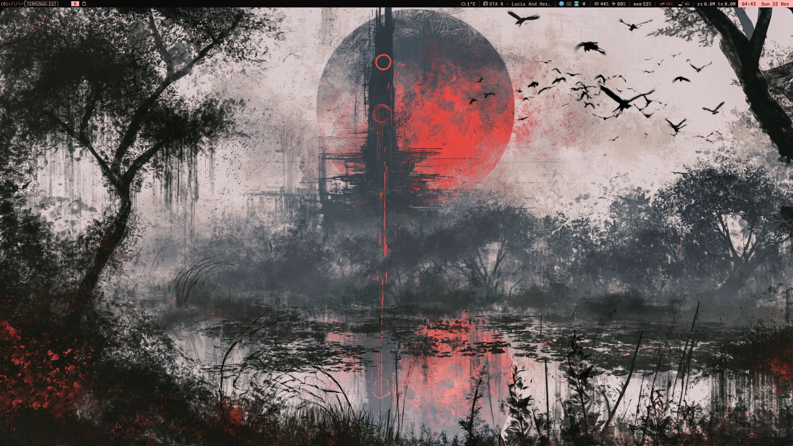
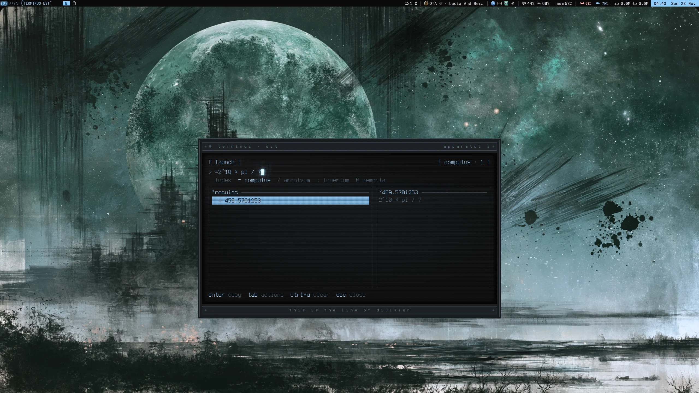
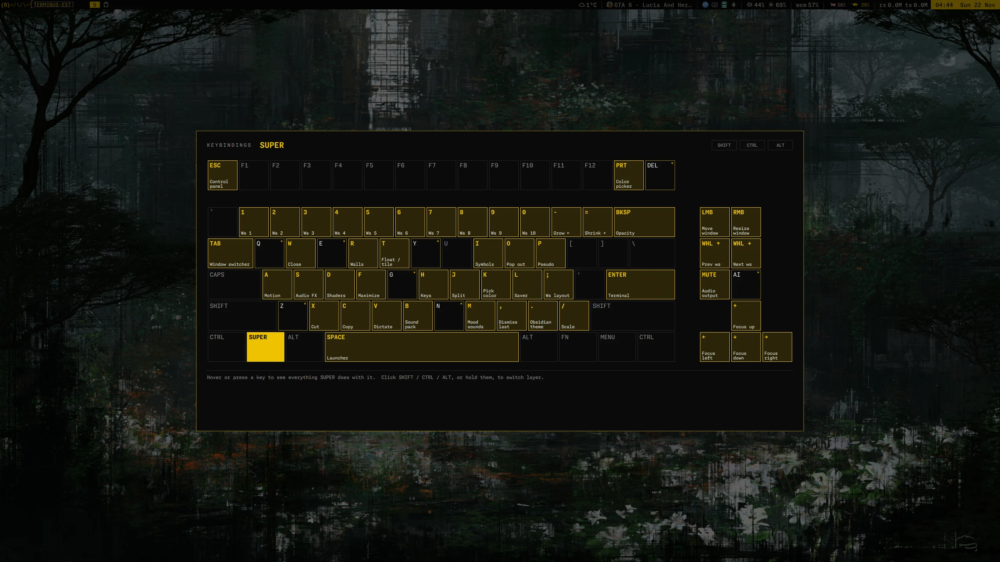
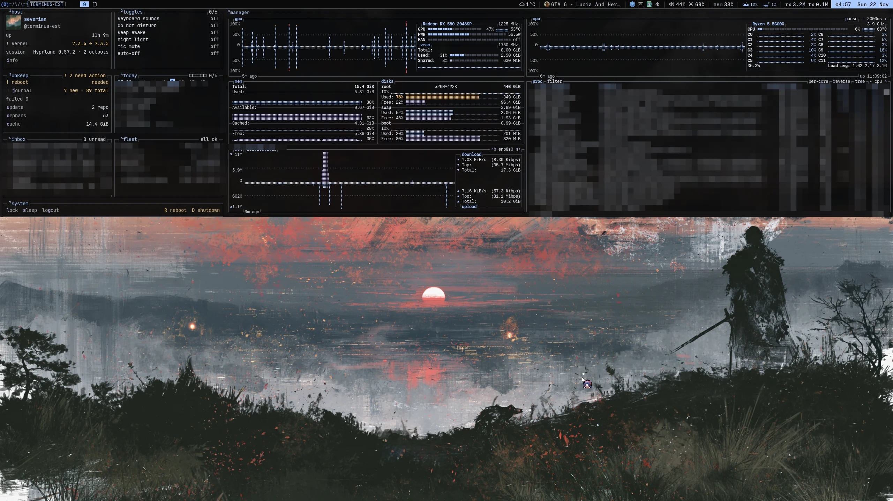

<p align="center">
  
</p>

<p align="center">
  <code>[ hyprland ]</code>&nbsp;<code>[ arch linux ]</code>&nbsp;<code>[ one palette ]</code>&nbsp;<code>[ mit ]</code>
</p>

<p align="center">
  
</p>

A Hyprland desktop for Arch Linux: one settings file, one palette, and a set of small tools around a bar, a launcher and the skins for Zed and the Strata file manager. The accent follows the wallpaper; everything else is drawn in neutrals, monospace and thin rules. It is a personal setup, kept in the open so it can be read and reused.

<p align="center">
  <a href="#apparatus">apparatus</a> ·
  <a href="#specimens">specimens</a> ·
  <a href="#install">install</a> ·
  <a href="#first-keys">first keys</a> ·
  <a href="#one-palette">one palette</a> ·
  <a href="#commands">commands</a> ·
  <a href="#origins">origins</a>
</p>

<a id="apparatus"></a>
### `¹ apparatus`

| | Component | What it is | Where |
|---|---|---|---|
| ¹ | **Terminus-Bar** | The bar, dashboard, quick panels and settings window (fork of noctalia, C++) | `modules/terminus-bar` `modules/terminus-bar-plugins` `modules/terminus-bar-menu-blur` `config/terminus-bar` |
| ² | **Terminus-Launcher** | CRT launcher: apps, calculator (computus), files (archivum), system (imperium), clipboard (memoria) | `modules/terminus-launcher` `config/terminus-launcher` |
| ³ | **Terminus-Settings** | One settings file, the design tokens, and the adapters that render every skin from them | `config/settings.toml` `lib/` `lib/skins/` |
| ⁴ | **Hyprland** | Bindings, window rules, look, animations; per-host hardware in `config/hosts/<hostname>/` | `config/hyprland` `config/uwsm` |
| ⁵ | **Desktop helpers** | The `terminus-*` helpers behind `terminus compat`, the menus and the theme (fork of Omarchy) | `modules/desktop` `config/current` `config/themes` |
| ⁶ | **Pickers** | Motion (window animations, effects, cursors), screen shaders, audio effects, key sounds, symbols | `config/motion` `config/shaders` `config/audiofx` `modules/hyprland-plugins` `modules/overlays` |
| ⁷ | **Terminus-TaskManager** | System monitor for the terminal in btop's design (Rust) | `modules/terminus-taskmanager` |
| ⁸ | **Terminus-Keys** | `SUPER+H`: every SUPER binding drawn on a keyboard | `modules/terminus-keys` |
| ⁹ | **Login and lock** | Ly login screen build and its appearance, screensaver, laptop lock | `modules/login-ly` `config/hyprlock` `config/terminus-screensaver` |
| ¹⁰ | **Zed** · **Strata** | Editor settings and theme; file manager stylesheet and sidebar icons | `config/zed` `config/strata` `lib/skins/` |

How the parts connect, what is generated and which file to change for what: [`docs/ARCHITECTURE.md`](docs/ARCHITECTURE.md).

<a id="specimens"></a>
### `² specimens`

<table>
  <tr>
    <td width="50%"></td>
    <td width="50%"></td>
  </tr>
  <tr>
    <td align="center"><code>[ launcher · computus ]</code></td>
    <td align="center"><code>[ motion · super+a ]</code></td>
  </tr>
  <tr>
    <td width="50%"></td>
    <td width="50%"></td>
  </tr>
  <tr>
    <td align="center"><code>[ keys · super layer ]</code></td>
    <td align="center"><code>[ settings · look ]</code></td>
  </tr>
  <tr>
    <td width="50%"></td>
    <td width="50%"></td>
  </tr>
  <tr>
    <td align="center"><code>[ control center · dashboard ]</code></td>
    <td align="center"><code>[ strata · skin ]</code></td>
  </tr>
</table>

Each specimen is a different wallpaper; the accent (clock, selection, borders, keys) is picked from it. Personal panels (calendar, inbox, devices, processes, pinned folders) are pixelated.

<p align="center">
  
</p>

The seventeen wallpapers in the specimens ship in `wallpapers/` (2944×1648 JPEG). The installer links them as `~/Pictures/Wallpapers/Terminus Est`, where Skwd Wall finds them; pick one with `SUPER+R` and the palette follows.

<a id="install"></a>
### `³ install`

You need Arch Linux (or a derivative with pacman), a GPU that runs Hyprland, about 3 GB of free disk and ten minutes for the first build of the bar. An AUR helper (paru or yay) is optional.

```sh
curl -fsSL https://raw.githubusercontent.com/severian607/Terminus-Est/main/install.sh | bash
```

Read [`install.sh`](install.sh) first if you like; it is short and asks for sudo only for pacman.

`install.sh`:

- installs the packages with pacman, plus Skwd Wall, Mechvibes and python-sounddevice from the AUR when paru or yay is present (`bash -s -- --no-packages` skips this);
- installs the Consoleet Terminus font the launcher is drawn in;
- clones the repository to `~/Projects/Terminus-Est` (units and bindings expect that path);
- links the configuration into `~/.config` and `~/.local`, moving anything already there to `~/.local/state/terminus-est/install-backup/<time>/`;
- adds one import line to `~/.config/gtk-3.0/gtk.css` and `gtk-4.0/gtk.css` and three include lines to `~/.config/ghostty/config`, so GTK applications and Ghostty follow the palette (your own settings in those files stay);
- builds the bar and the Hyprland plugins, renders the skins and enables the user units.

Running it again updates and relinks. Then log in to the *Hyprland (uwsm-managed)* session. Outputs come up at their preferred mode; to name a main monitor or set modes, see the comment in `config/hyprland/monitors.lua`.

**Per machine.** What differs between machines goes in `config/hosts/<hostname>/`: `hyprland/monitors.lua` there replaces the default, `hyprland/host.lua` is loaded after the input module and `hyprland/host_bindings.lua` after the shared bindings; `hypridle.conf` replaces the generated idle configuration, and a file `secure-lock` makes locking authenticate (it needs a hyprlock build with `--ready-fd`, named by `TERMINUS_HYPRLOCK`; without it the screensaver blanks the screen but does not lock). [`docs/examples/hosts/laptop/`](docs/examples/hosts/laptop) is a worked example to copy. An empty file `config/hosts/<hostname>/autostart-omp` starts omp with the session.

**Updating.** `terminus-update` pulls, rebuilds what changed and reloads. To run it after every pacman upgrade:

```sh
sed "s/@USER@/$USER/g" ~/Projects/Terminus-Est/config/pacman/terminus-est.hook | sudo install -Dm644 /dev/stdin /etc/pacman.d/hooks/terminus-est.hook
```

**Removing.** Nearly everything the installer put in your home is a link into the repository, so removing it is three steps:

```sh
systemctl --user stop 'terminus-*'
find ~/.config ~/.local ~/Pictures/Wallpapers -lname "$HOME/Projects/Terminus-Est/*" -delete
rm -rf ~/Projects/Terminus-Est        # your earlier files are in ~/.local/state/terminus-est/install-backup/
```

Not links, so left behind: the import line in the two `gtk.css` files, the three include lines in `~/.config/ghostty/config`, the font in `~/.local/share/fonts`, the bar's own state in `~/.local/state/terminusbar` and, if you installed it, `/usr/local/libexec/terminus-login-apply`.

**If something is off.** `journalctl --user -u terminus-bar -e` shows the bar's log, `hyprctl configerrors` the compositor's, and `terminus-settings validate` checks the settings file. The Hyprland plugins must match the installed Hyprland; `terminus-update` rebuilds them after an upgrade. Mood sounds are not included: copy the Mechvibes repository's `assets/sounds` to `~/.local/share/terminus-est/mood`.

<a id="first-keys"></a>
### `⁴ first keys`

`SUPER+H` draws every binding on a keyboard; these are the ones to start with.

| Key | Does |
|---|---|
| `SUPER+SPACE` | Launcher. Type to search apps; start with `=` to calculate, `/` for files, `:` for system actions, `@` for the clipboard |
| `SUPER+ESCAPE` | Control center: host, toggles, upkeep, today, inbox, fleet and the task manager |
| `SUPER+RETURN` | Terminal |
| `SUPER+SHIFT+F` | Strata file manager |
| `SUPER+TAB` | Window switcher |
| `SUPER+W` · `SUPER+T` · `SUPER+F` | Close window · float or tile · full width |
| `SUPER+R` | Wallpaper picker (Skwd Wall); the accent follows the choice |
| `SUPER+A` · `SUPER+D` · `SUPER+S` | Pickers: motion · screen shaders · audio effects |
| `SUPER+B` · `SUPER+M` | Key sound packs · mood sounds |
| `SUPER+I` | Insert a Unicode symbol into the focused window |
| `SUPER+CTRL+L` | Light or dark, for the bar, Zed and Obsidian together |
| `SUPER+ALT+SPACE` | Settings window |
| `SUPER+H` | The keyboard overlay |

<a id="one-palette"></a>
### `⁵ one palette`

`config/settings.toml` `[appearance]` holds the colours, opacities and the interface font. The neutrals are fixed; the accent follows the wallpaper: `tools/terminus-skwd-palette` sets it whenever Skwd Wall changes the scheme.

`terminus-settings apply` renders every skin from that palette: Strata, Zed, the launcher, mako, SwayOSD, GTK colours, the Ghostty background, cursor and light mode, and the Hyprland borders. Generated files are listed in `.gitignore`; change the palette or the templates in `lib/skins/`, not the output.

<a id="commands"></a>
### `⁶ commands`

| Command | Purpose |
|---|---|
| `terminus` | Dispatcher: `terminus bar ...`, `terminus launcher ...`, `terminus menu NAME`, `terminus compat HELPER` |
| `terminus-settings` | The settings window; `get`, `set KEY VALUE ...`, `apply`, `validate` on `config/settings.toml` |
| `terminus-update` | Pull, link new units, rebuild the bar and plugins when needed, re-render, reload |
| `terminus-bar` | The bar; `terminus-bar msg ...` talks to the running one |
| `terminus-bar-style` | `list`, `current`, `set NAME`, `save NAME`: bar designs in `config/terminus-bar/presets/` (classic, tmux, frame, deck) |
| `terminus-launcher` | `toggle`, `open`, `close`, `search TEXT`, `pin DIGIT APP`, `slots`, `theme-reload` |
| `terminus-motion` `terminus-shaders` `terminus-audio` `terminus-keysounds` `terminus-symbols` | The pickers (`SUPER+A`, `SUPER+D`, `SUPER+S`, `SUPER+B`, `SUPER+I`) |
| `terminus-motionfx` `terminus-screenfx` `terminus-audiofx` `terminus-funmode` | Engines behind the pickers |
| `terminus-mechvibes` | Sound packs, looped mood sounds and the shared volume behind `SUPER+B` |
| `terminus-taskmanager` | System monitor ([keys](modules/terminus-taskmanager/README.md)) |
| `terminus-keys` | Keybinding overlay |
| `terminus-screensaver` `terminus-lock` `terminus-login` | Screensaver, laptop lock supervisor, login appearance |
| `terminus-transparency` | Window opacity toggles |

**Code style.** Terminus-Est's own code is kept formatted and linted: Python with `uvx ruff format` and `uvx ruff check` (`ruff.toml`), shell with `shfmt -i 2 -ci` and `shellcheck`, the bar's C++ with `modules/terminus-bar/.clang-format`, Rust with `cargo fmt` and `cargo clippy`. In the forks, only the files Terminus wrote follow it; upstream files keep their style.

<a id="origins"></a>
### `⁷ origins`

Terminus-Est is released under the MIT licence (`LICENSE`), except where a directory carries its own:

- `modules/terminus-bar` is a fork of [noctalia](https://github.com/noctalia-dev/noctalia) (MIT); its `CREDITS.md` and `LICENSE` keep the original attribution.
- `modules/desktop` is a fork of [Omarchy](https://github.com/basecamp/omarchy) (MIT).
- `modules/terminus-launcher` derives from the [SekaiPop](https://github.com/Blapples/SekaiPop) shell (GPL-3.0, see its `LICENSE`).
- `modules/hyprland-plugins/*` keep their upstream licences (MIT or BSD-3-Clause, see each `LICENSE` and `UPSTREAM`); one shader, `hyprwindowshade/shaders/close/fire_close.glsl`, is GPL-3.0-or-later (`LICENSE.GPL-3.0` beside it).
- `modules/terminus-bar-plugins/cat` (DotNetRob) and `noctwhspr` (goodroot) come from noctalia's [community plugins](https://github.com/noctalia-dev/community-plugins) (MIT as declared in each `plugin.toml`; see each `UPSTREAM`).
- The launcher font is [Consoleet Terminus](https://inai.de/projects/consoleet/terminus) (OFL), downloaded by the installer.

This repository is a snapshot of the maintainer's private one: Terminus-Est itself plus the Zed and Strata skins. Configuration for other programs, personal accounts, host configurations and media without a redistribution licence stay private. The Omarchy themes come without their wallpapers and previews, and the Omarchy web-app icons are left out; both are in the [Omarchy](https://github.com/basecamp/omarchy) repository. Some bindings in `config/hyprland/application_bindings.lua` start the maintainer's own programs (omp, Obsidian, rnote, hyprwhspr); they do nothing where those are not installed.

<p align="center"><sub>t h i s &nbsp; i s &nbsp; t h e &nbsp; l i n e &nbsp; o f &nbsp; d i v i s i o n</sub></p>
