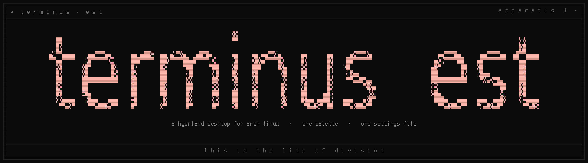
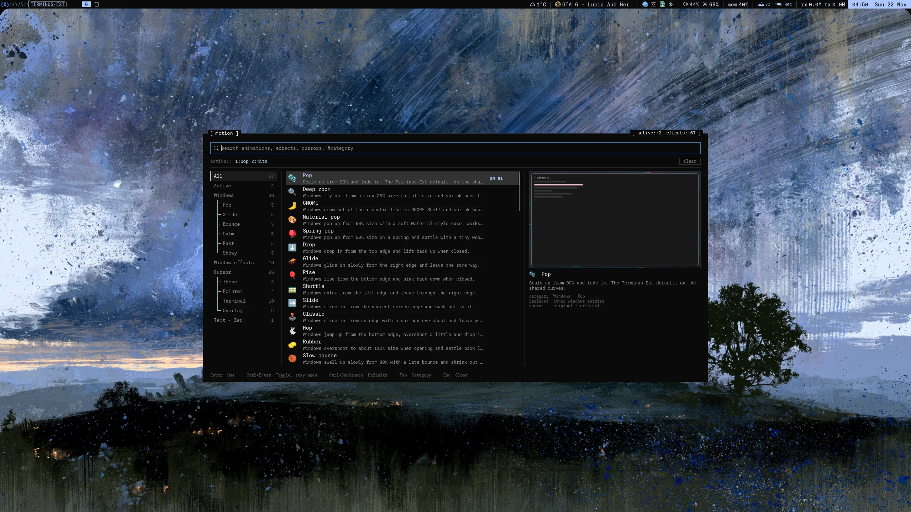
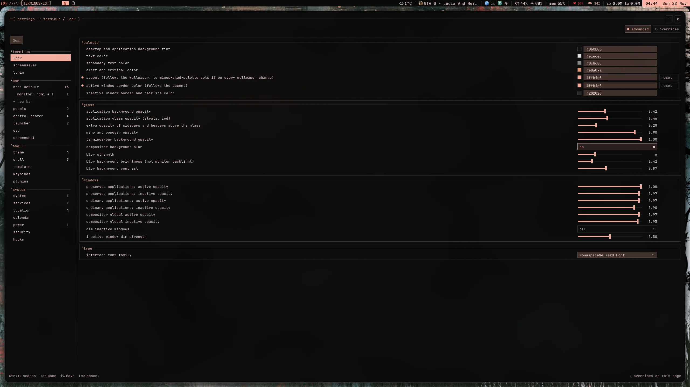
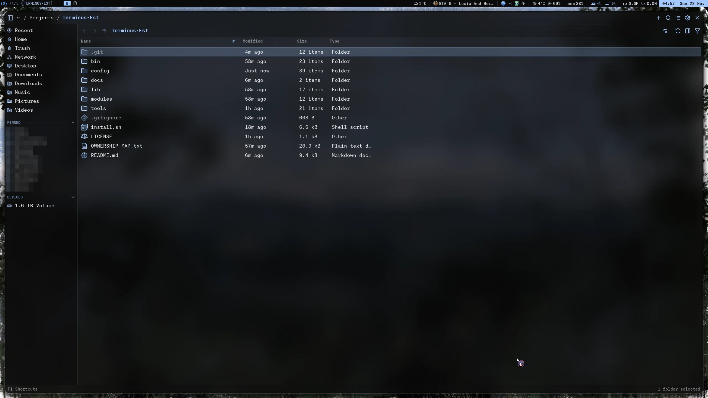
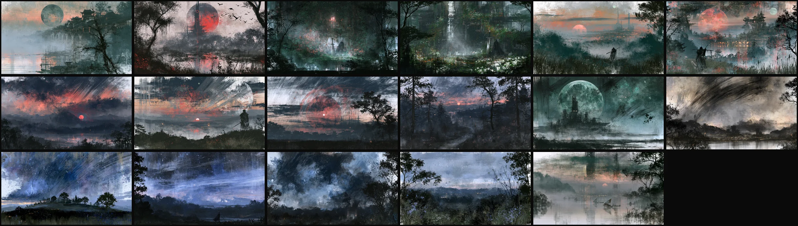

<p align="center">
  
</p>

<p align="center">
  <code>[ hyprland ]</code>&nbsp;<code>[ arch linux ]</code>&nbsp;<code>[ one palette ]</code>&nbsp;<code>[ mit ]</code>
</p>

<p align="center">
  
</p>

A Hyprland desktop for Arch Linux: one settings file, one palette, and a set of small tools around a bar, a launcher and the skins for Zed and the Strata file manager. The accent follows the wallpaper; everything else is drawn in neutrals, monospace and thin rules. It is a personal setup, kept in the open so it can be read and reused.

```text
───┤ ¹ apparatus ├──────────────────────────────────────────────────────────────────
```

| | Component | What it is | Where |
|---|---|---|---|
| ¹ | **Terminus-Bar** | The bar, dashboard, quick panels and settings window (fork of noctalia, C++) | `modules/terminus-bar` `modules/terminus-bar-plugins` `modules/terminus-bar-menu-blur` `config/terminus-bar` |
| ² | **Terminus-Launcher** | CRT launcher: apps, calculator (computus), files (archivum), system (imperium), clipboard (memoria) | `modules/terminus-launcher` `config/terminus-launcher` |
| ³ | **Terminus-Settings** | One settings file, the design tokens, and the adapters that render every skin from them | `config/settings.toml` `lib/` `lib/skins/` |
| ⁴ | **Hyprland** | Bindings, window rules, look, animations; per-host hardware in `config/hosts/<hostname>/` | `config/hyprland` `config/uwsm` |
| ⁵ | **Desktop helpers** | The `terminus-*` helpers behind `terminus compat`, the menus and the theme (fork of Omarchy) | `modules/desktop` `config/current` `config/themes` |
| ⁶ | **Pickers** | Motion (window animations, effects, cursors), screen shaders, audio effects, key sounds, symbols | `config/motion` `config/shaders` `config/audiofx` `modules/hyprland-plugins` `modules/overlays` |
| ⁷ | **Terminus-TaskManager** | System monitor for the terminal in btop's design (Rust) | `modules/terminus-taskmanager` |
| ⁸ | **Terminus-Keys** | `SUPER+H`: every SUPER binding drawn on a keyboard | `modules/terminus-keys` |
| ⁹ | **Login and lock** | Ly login screen build and its appearance, screensaver, laptop lock | `modules/login-ly` `config/hyprlock` `config/terminus-screensaver` |
| ¹⁰ | **Zed** · **Strata** | Editor settings and theme; file manager stylesheet and sidebar icons | `config/zed` `config/strata` `lib/skins/` |

```text
───┤ ² specimens ├──────────────────────────────────────────────────────────────────
```

<table>
  <tr>
    <td width="50%"></td>
    <td width="50%"></td>
  </tr>
  <tr>
    <td align="center"><code>[ launcher · computus ]</code></td>
    <td align="center"><code>[ motion · super+a ]</code></td>
  </tr>
  <tr>
    <td width="50%"></td>
    <td width="50%"></td>
  </tr>
  <tr>
    <td align="center"><code>[ keys · super layer ]</code></td>
    <td align="center"><code>[ settings · look ]</code></td>
  </tr>
  <tr>
    <td width="50%"></td>
    <td width="50%"></td>
  </tr>
  <tr>
    <td align="center"><code>[ control center · dashboard ]</code></td>
    <td align="center"><code>[ strata · skin ]</code></td>
  </tr>
</table>

Each specimen is a different wallpaper; the accent (clock, selection, borders, keys) is picked from it. Personal panels (calendar, inbox, devices, processes, pinned folders) are pixelated.

<p align="center">
  
</p>

The seventeen wallpapers in the specimens ship in `wallpapers/` (2944×1648 JPEG). The installer links them as `~/Pictures/Wallpapers/Terminus Est`, where Skwd Wall finds them; pick one with `SUPER+R` and the palette follows.

```text
───┤ ³ install ├────────────────────────────────────────────────────────────────────
```

On Arch Linux:

```sh
curl -fsSL https://raw.githubusercontent.com/severian607/Terminus-Est/main/install.sh | bash
```

`install.sh`:

- installs the packages with pacman, plus Skwd Wall, Mechvibes and python-sounddevice from the AUR when paru or yay is present (`bash -s -- --no-packages` skips this);
- installs the Consoleet Terminus font the launcher is drawn in;
- clones the repository to `~/Projects/Terminus-Est` (units and bindings expect that path);
- links the configuration into `~/.config` and `~/.local`, moving anything already there to `~/.local/state/terminus-est/install-backup/<time>/`;
- builds the bar and the Hyprland plugins, renders the skins and enables the user units.

Running it again updates and relinks. Then log in to the *Hyprland (uwsm-managed)* session and set your outputs in `config/hyprland/monitors.lua`.

Machine-specific hardware goes in `config/hosts/<hostname>/`: in its `hyprland/` folder, `monitors.lua` replaces the default, `host.lua` is loaded after the input module and `host_animations.lua` after the motion. Marker files there switch per-host behaviour: `secure-lock` makes `terminus system lock` run `terminus-lock` (a hyprlock supervisor), `autostart-omp` starts omp with the session.

Mood sounds are not included; copy the Mechvibes repository's `assets/sounds` to `~/.local/share/terminus-est/mood`.

```text
───┤ ⁴ one palette ├────────────────────────────────────────────────────────────────
```

`config/settings.toml` `[appearance]` holds the colours, opacities and the interface font. The neutrals are fixed; the accent follows the wallpaper: `tools/terminus-skwd-palette` sets it whenever Skwd Wall changes the scheme.

`terminus-settings apply` renders every skin from that palette: Strata, Zed, the launcher, mako, SwayOSD, GTK colours, the Ghostty override and the Hyprland borders. Generated files are listed in `.gitignore`; change the palette or the templates in `lib/skins/`, not the output.

```text
───┤ ⁵ commands ├───────────────────────────────────────────────────────────────────
```

| Command | Purpose |
|---|---|
| `terminus` | Dispatcher: `terminus bar ...`, `terminus launcher ...`, `terminus menu NAME`, `terminus compat HELPER` |
| `terminus-settings` | The settings window; `get`, `set KEY VALUE ...`, `apply`, `validate` on `config/settings.toml` |
| `terminus-update` | Pull, link new units, rebuild the bar and plugins when needed, re-render, reload. `config/pacman/terminus-est.hook` runs it after every upgrade |
| `terminus-bar` | The bar; `terminus-bar msg ...` talks to the running one |
| `terminus-bar-style` | `list`, `current`, `set NAME`, `save NAME`: bar designs in `config/terminus-bar/presets/` (classic, tmux, frame, deck) |
| `terminus-launcher` | `toggle`, `open`, `close`, `search TEXT`, `pin DIGIT APP`, `slots`, `theme-reload` |
| `terminus-motion` `terminus-shaders` `terminus-audio` `terminus-keysounds` `terminus-symbols` | The pickers (`SUPER+A`, `SUPER+D`, `SUPER+S`, `SUPER+B`, `SUPER+I`) |
| `terminus-motionfx` `terminus-screenfx` `terminus-audiofx` `terminus-funmode` | Engines behind the pickers |
| `terminus-mechvibes` | Sound packs, looped mood sounds and the shared volume behind `SUPER+B` |
| `terminus-taskmanager` | System monitor ([keys](modules/terminus-taskmanager/README.md)) |
| `terminus-keys` | Keybinding overlay |
| `terminus-screensaver` `terminus-lock` `terminus-login` | Screensaver, laptop lock supervisor, login appearance |
| `terminus-transparency` | Window opacity toggles |

To follow every pacman upgrade:

```sh
sed "s/@USER@/$USER/g" ~/Projects/Terminus-Est/config/pacman/terminus-est.hook | sudo install -Dm644 /dev/stdin /etc/pacman.d/hooks/terminus-est.hook
```

```text
───┤ ⁶ origins ├────────────────────────────────────────────────────────────────────
```

Terminus-Est is released under the MIT licence (`LICENSE`), except where a directory carries its own:

- `modules/terminus-bar` is a fork of [noctalia](https://github.com/noctalia-dev/noctalia) (MIT); its `CREDITS.md` and `LICENSE` keep the original attribution.
- `modules/desktop` is a fork of [Omarchy](https://github.com/basecamp/omarchy) (MIT).
- `modules/terminus-launcher` derives from the [SekaiPop](https://github.com/Blapples/SekaiPop) shell (GPL-3.0, see its `LICENSE`).
- `modules/hyprland-plugins/*` keep their upstream licences (MIT or BSD-3-Clause, see each `LICENSE` and `UPSTREAM`).
- The launcher font is [Consoleet Terminus](https://inai.de/projects/consoleet/terminus) (OFL), downloaded by the installer.

This repository is a snapshot of the maintainer's private one, made by `tools/terminus-publish`: Terminus-Est itself plus the Zed and Strata skins. Configuration for other programs, personal accounts, host configurations and media without a redistribution licence stay private. The Omarchy themes come without their wallpapers and previews, and the Omarchy web-app icons are left out; both are in the [Omarchy](https://github.com/basecamp/omarchy) repository.

<p align="center"><sub>t h i s &nbsp; i s &nbsp; t h e &nbsp; l i n e &nbsp; o f &nbsp; d i v i s i o n</sub></p>
