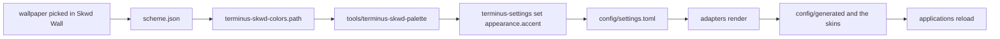

# Architecture

Where everything lives, what is generated, and what talks to what. The README says what Terminus-Est is; this file is for changing it.

## Rules

- The repository is the desktop. Programs keep their usual configuration paths, and those paths are symbolic links into the checkout (`~/Projects/Terminus-Est`). Edit the file in the repository, never a copy elsewhere.
- One settings file, `config/settings.toml`, is the source for appearance and session settings. Do not keep a second set of colours in an application's own configuration.
- Generated files are written by `terminus-settings` and are listed in `.gitignore`. Change the setting or the template, not the output.
- Application state (histories, databases, credentials, caches) stays where the application puts it and is never tracked.

## Layout

| Path | Holds | Live as |
|---|---|---|
| `bin/` | Commands: `terminus`, `terminus-settings`, `terminus-update`, the pickers and effect engines | links in `~/.local/bin` |
| `lib/` | Python behind the commands: settings pipeline, colour tokens, skin adapters, picker panels; templates in `lib/skins/` | imported from the checkout |
| `config/` | Live configuration | `~/.config/terminus-est` |
| `config/hyprland/` | Hyprland Lua | `~/.config/hypr/hyprland.lua` (plus `hyprsunset.conf`, `xdph.conf`) |
| `config/hosts/<hostname>/` | Per-machine files, see below | read in place |
| `config/systemd/user/`, `config/dbus-1/services/` | Units and D-Bus activation files | links in `~/.config/systemd/user`, `~/.local/share/dbus-1/services` |
| `modules/` | The programs: bar, launcher, task manager, bar plugins, overlays, Hyprland plugins, desktop helpers, login patch | built or run in place |
| `tools/` | Helpers run by units or by hand: palette sync, preview recorders, generators | run in place |

## Settings and the palette

- `lib/settings.py` loads the file, validates it against a typed schema (`terminus-settings schema`) and runs the adapters. Writes are atomic and serialised by a lock; a failed adapter rolls the started writes back.
- `lib/tokens.py` derives the full token set (surface, outline, dim accent, text on accent and the rest) from the few stored colours and fills templates.
- Adapters: `appearance`, `session`, `skin_strata`, `skin_zed`, `skin_launcher`, `skin_notify`, `skin_gtk`. Each has a pure `render(settings, root)` and an `apply(settings, root, changed)` that pokes the running program and only acts on the live root.
- Neutrals are fixed. The accent follows the wallpaper.

| Output | Read by |
|---|---|
| `config/generated/appearance.lua` | Hyprland (`look_and_feel.lua`) |
| `config/generated/appearance-ghostty.conf` | Ghostty, through an include line the installer adds |
| `config/generated/gtk-colors.css` | GTK 3 and 4, through an `@import` line the installer adds |
| `config/generated/mako.ini` | mako (`~/.config/mako/config` links to it) |
| `config/generated/hypridle.conf`, `screensaver.env` | hypridle and the screensaver |
| `config/generated/strata.css`, `strata-theme.toml` | Strata (deployed as regular files in `~/.config/strata`) |
| `config/swayosd/style.css` | SwayOSD |
| `config/zed/themes/terminus-est.json` | Zed |
| `config/terminus-launcher/theme.json` | the launcher and the keys overlay |
| `config/terminus-bar/99-terminus-appearance.toml`, `palettes/Skwd Wall.json`, `95-skwd-font.toml` | the bar |

## Hyprland

`config/hyprland/hyprland.lua` loads, in order: `helpers`, `envs`, `monitors`, `input`, `bindings`, `application_bindings`, `windows`, `look_and_feel`, `animations`, `cursor`, `toggles`, `autostart`.

- `helpers.lua` defines the vocabulary the other files use: `o.bind(keys, label, action)`, `o.window{...}`, `o.command_exists(name)`, and `o.monitors`.
- Output names appear only in `monitors.lua`. Everything else reads `o.monitors.primary` and `o.monitors.secondary`.
- `toggles.lua` turns flag files under `~/.local/state/terminus-est/toggles/hypr/` into configuration, so a toggle survives a reload.
- Hyprland reloads when a file is saved. Check `hyprctl configerrors` afterwards.

### Per machine

A directory `config/hosts/<hostname>/` changes one machine without touching the shared files. `docs/examples/hosts/laptop/` is a worked example.

| File | Effect |
|---|---|
| `hyprland/monitors.lua` | replaces the shared `monitors.lua` |
| `hyprland/host.lua` | loaded after `input.lua` (touchpad, tablet, device settings) |
| `hyprland/host_bindings.lua` | loaded after the shared bindings (may unbind and rebind) |
| `hypridle.conf` | used as this machine's idle configuration instead of the generated one |
| `secure-lock` (any content) | `terminus system lock` starts the authenticating lock, not the screensaver |
| `screensaver-art` (any content) | this machine shows the alternative screensaver artwork |
| `autostart-omp` (any content) | starts omp with the session |

## The pieces

**Terminus-Bar** (`modules/terminus-bar`, C++, fork of noctalia v5.3.0). The binary and its own folders are named `terminusbar`. `config/terminus-bar/*.toml` are overlays over the built-in defaults, applied in name order; the bar's own runtime choices live in `~/.local/state/terminusbar/settings.toml`. Click panels (network, bluetooth, audio, brightness, weather, calendar, media) are quick panels in `src/shell/panel/quick_panel.*` hosting a tab from `src/shell/control_center/tabs/`. Everything is scriptable: `terminus-bar msg --help`. Plugins in `modules/terminus-bar-plugins` are Luau and are linked into `~/.local/share/terminusbar/plugins`.

**Terminus-Launcher** (`modules/terminus-launcher`, Quickshell QML, Super+Space). A provider answers a query: Index (applications), Archivum `/` (files, needs `fd`), Computus `=` (calculator, needs `qalc`), Imperium `:` (commands), Memoria `@` (clipboard history from the bar). Ranking is fuzzy match plus frecency; state is in `~/.local/state/terminus-launcher`.

**Pickers** (`lib/shader_panel.py`, `lib/symbol_panel.py`, GTK). Motion (Super+A), screen shaders (Super+D), symbols (Super+I), audio effects (Super+S) and key sounds (Super+B). Each is a user service that D-Bus starts on the first key press. Entries are plain files: `config/motion/<group>/<name>.{lua,glsl,sh}` and `config/shaders/*.frag`, each with a comment header (label, category, slot). The engines are `bin/terminus-motionfx`, `bin/terminus-screenfx` and `bin/terminus-audiofx`. Preview clips are recorded by `tools/terminus-motion-previews` and `tools/terminus-screenfx-previews` in a nested Hyprland on a hidden output (`tools/terminus-motion-sandbox`), so nothing is loaded into the real session.

**Terminus-Keys** (`modules/terminus-keys`, Super+H). An overlay of the live bindings, read from `hyprctl binds`.

**Task manager** (`modules/terminus-taskmanager`, Rust). Built on demand by `bin/terminus-taskmanager`; also embedded in the bar's dashboard. `config/udev/70-terminus-cpu-energy.rules` opens the CPU energy counter for the watts reading and has to be copied to `/etc/udev/rules.d/` by hand.

**Overlays** (`modules/overlays`, C). Pointer effects on a layer surface, started by motion entries.

**Hyprland plugins** (`modules/hyprland-plugins`, `modules/terminus-bar-menu-blur`). Third-party plugins built here; each has an `UPSTREAM` file. They must match the installed Hyprland, and `terminus-update` rebuilds them when it changes.

**Desktop helpers** (`modules/desktop`, fork of Omarchy 3.8.2). Menus, capture, toggles, package helpers. `terminus <group> <command>` reaches them through `bin/desktop-core`; `terminus commands --all` lists them. Its own `install.sh` is the unused upstream installer.

**Screensaver and idle.** `bin/terminus-screensaver` is a blanking surface that does not authenticate. `hypridle.service` (the packaged unit) is the only idle daemon. The authenticating lock is `bin/terminus-lock`, used on machines with `secure-lock`; it needs a hyprlock build that can report readiness (`TERMINUS_HYPRLOCK`).

**Notifications and OSD.** mako draws notifications and SwayOSD the volume and brightness popups; the bar's own notification daemon and volume OSD are switched off in `config/terminus-bar/94-desktop.toml` and `96-osd.toml`.

**Cursor themes.** `modules/terminus-cursor` and `modules/terminus-eclipse-cursor` build a theme per accent into `~/.cache/terminus-est/` and link it from `~/.local/share/icons`.

**Login.** `modules/login-ly` is a patch set for the Ly display manager, built as a package on the machine that uses it. Cosmetic login settings are staged in `config/login/appearance.json` and applied by the root-owned helper `/usr/local/libexec/terminus-login-apply` (source: `tools/terminus-login-apply`), which accepts only an approved list of fields.

## Units

| Unit | Runs |
|---|---|
| `terminus-bar.service`, `terminus-launcher.service` | the bar and the launcher |
| `terminus-motion`, `terminus-shaders`, `terminus-symbols`, `terminus-audio`, `terminus-keysounds` | the pickers, D-Bus activated (`local.terminus.*`) |
| `terminus-skwd-colors.path` and `.service` | palette sync when the wallpaper scheme changes |
| `terminus-strata-skin.path` and `.service` | redeploys the Strata skin when its bookmarks change |
| `terminus-vitals-log.service` | the history behind the vitals panel |
| `terminus-lock.service` | the authenticating lock |
| `easyeffects.service` | audio effects, started on demand by `terminus-audiofx` |
| `swayosd-server.service` | SwayOSD |

`mako`, `hypridle` and `skwd-walld` are the packaged units.

## Install and update

- `install.sh` installs packages, clones, links, builds and renders, and enables the user units. It moves anything already at a link's place into a dated backup directory.
- `terminus-update` fast-forwards the checkout and brings the machine in line with what changed: new links, a bar rebuild when its sources changed, plugin rebuilds when Hyprland changed, a settings render, service restarts. Local edits to tracked files are kept; where they collide with an incoming change the local version of those lines wins. A pacman hook (`config/pacman/terminus-est.hook`) runs it after upgrades.
